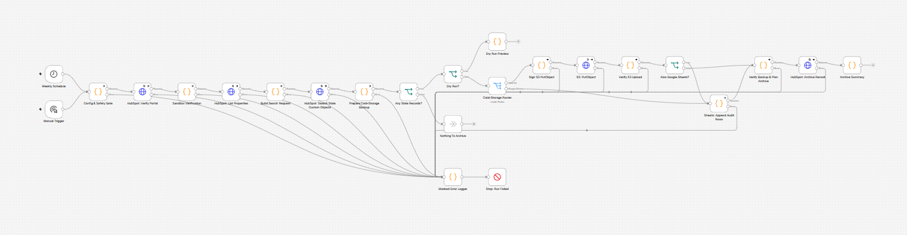

# n8n-hubspot-custom-object-retention-archiver

A weekly data-hygiene job for HubSpot **custom objects**. It finds records that nobody has touched for longer than a retention threshold (`RETENTION_DAYS=365` by default). It writes a **checksum-verified, immutable backup** of every one of them to cold storage (**AWS S3** and/or **Google Sheets**). Only then does it archive them in HubSpot with `DELETE /crm/v3/objects/{objectType}/{objectId}`, which moves them to the recycle bin.

The repository ships two equivalent runtimes:

| Runtime | Use it for |
|---|---|
| `workflows/n8n-hubspot-custom-object-retention-archiver.json` | Scheduled runs inside n8n |
| `src/` Node.js CLI | Local runs, CI, plain cron hosts, offline previews |

Both run **the same code**. The n8n Code nodes are generated from `src/hash.js`, `src/sigv4.js`, `src/safety.js` and `src/archiver.js`. The test suite executes those nodes and checks that their output matches the CLI byte for byte.

Zero runtime dependencies (no `aws-sdk`, no Google client libraries). Zero test dependencies. Node.js 18 or later.

---

## Contents

- [Safety model](#safety-model)
- [Architecture](#architecture)
- [Retention logic](#retention-logic)
- [Cold-storage schema](#cold-storage-schema)
- [Configuration](#configuration)
- [HubSpot setup](#hubspot-setup)
- [AWS S3 setup](#aws-s3-setup)
- [Google Sheets setup](#google-sheets-setup)
- [n8n setup](#n8n-setup)
- [Node.js CLI](#nodejs-cli)
- [Recovery and restoration](#recovery-and-restoration)
- [Testing](#testing)
- [Repository layout](#repository-layout)
- [Limitations](#limitations)

---

## Safety model

| Guardrail | Behaviour |
|---|---|
| **Read-only dry run by default** | `DRY_RUN=true` fetches stale records and builds the full JSON/CSV backup and archive plan, then makes **zero writes** to S3, Google Sheets or files and **zero `DELETE` calls** to HubSpot. Only an explicit `false` (or `0`, `no`, `off`) disables it; a typo such as `flase` keeps it on. |
| **Sandbox gate by default** | `SANDBOX_MODE=true` calls `GET /account-info/v3/details` first and aborts before any record is read unless `accountType` is `SANDBOX` or `DEVELOPER_TEST`. |
| **Backup before archive** | Records are archived only after **every** configured storage target has verified **this run's** backup. For S3, that means HTTP 200 plus S3 echoing the exact SHA-256 sent in `x-amz-checksum-sha256`, for both the JSON and the CSV object. For Sheets, the API must report exactly the number of rows sent. For local files, the bytes are read back and re-hashed. Any failure aborts the run and no `DELETE` is sent. In n8n this is enforced twice: by the wiring, and by the *Verify Backup & Plan Archive* node, which refuses to emit a single item without the verifications. |
| **Immutable backups** | S3 writes use `If-None-Match: *`, so an existing object is never overwritten, and checksums let S3 reject corrupted uploads. Local files are created write-once (`wx`). Each run gets a unique `runId`. |
| **Batch cap** | `MAX_ARCHIVE_PER_RUN=500` by default (maximum 10,000). The search stops paginating at the cap, the selection is truncated to it, and the cap is asserted again right before archiving. |
| **Conservative bounds** | `RETENTION_DAYS` must be between 30 and 3650. `CUSTOM_OBJECT_TYPE` must be a custom object (`2-<id>` or `p<portal>_<name>`); contacts, companies, deals and other standard objects are refused. Records with no retention date, with recent activity, or under legal hold are never selected. |
| **Overrides only make live runs safer** | In a live run, `--retention-days` may only raise retention and `--max-archive` may only lower the cap. No flag can disable `DRY_RUN` or `SANDBOX_MODE`. Offline mode is always a dry run. |
| **Environment-only secrets** | Every secret and sensitive identifier is read from `$env` (n8n) or `process.env` (CLI). `YOUR_*` placeholders count as unset. Workflow item data carries only presence flags. The S3 session token is added by the HTTP node from `$env`, and the Google access token never leaves the Sheets node. |
| **Masked logging** | All errors pass through `maskError()` / `maskSecrets()`. These remove known secret values, service-account internals, the portal ID, bearer and HubSpot `pat-` tokens, AWS key IDs, SigV4 credentials and signatures, Google `ya29.` tokens, JWTs, PEM private keys, UUID-style IDs and email addresses. |

---

## Architecture



```
 ┌──────────────────┐   ┌────────────────┐
 │ Weekly Schedule  │   │ Manual Trigger │
 │ (Sun 03:00)      │   └───────┬────────┘
 └────────┬─────────┘           │
          └──────────┬──────────┘
                     ▼
       ┌───────────────────────────┐  $env → resolveConfig(): DRY_RUN / SANDBOX_MODE default true,
       │   Config & Safety Gate    │  RETENTION_DAYS 30–3650, MAX_ARCHIVE_PER_RUN ≤ 10000,
       └─────────────┬─────────────┘  custom objects only; secrets never enter item data
                     ▼
       ┌───────────────────────────┐
       │  HubSpot: Verify Portal   │  GET /account-info/v3/details
       └─────────────┬─────────────┘
                     ▼
       ┌───────────────────────────┐  accountType must be SANDBOX or DEVELOPER_TEST
       │   Sandbox Verification    │  (unless SANDBOX_MODE=false)
       └─────────────┬─────────────┘
                     ▼
       ┌───────────────────────────┐
       │ HubSpot: List Properties  │  GET /crm/v3/properties/{objectType}  → full-property backup
       └─────────────┬─────────────┘
                     ▼
       ┌───────────────────────────┐  cutoff = UTC day start − RETENTION_DAYS
       │   Build Search Request    │  filters: DATE_PROPERTY < cutoff [AND activity < cutoff OR empty]
       └─────────────┬─────────────┘
                     ▼
       ┌───────────────────────────┐  POST /crm/v3/objects/{objectType}/search
       │ HubSpot: Search Stale ... │  oldest first, paginated, stops at MAX_ARCHIVE_PER_RUN
       └─────────────┬─────────────┘
                     ▼
       ┌───────────────────────────┐  client-side re-check (legal hold, dates), cap,
       │ Prepare Cold-Storage      │  deterministic JSON + formula-safe CSV + ledger rows,
       │ Backup                    │  per-record and manifest SHA-256, S3 keys
       └─────────────┬─────────────┘
                     ▼
              ┌──────────────┐  no  ┌────────────────────┐
              │Any Stale     ├─────►│ Nothing To Archive │
              │Records?      │      └────────────────────┘
              └──────┬───────┘
                     │ yes
              ┌──────▼───────┐ yes  ┌────────────────────┐
              │  Dry Run?    ├─────►│  Dry Run Preview   │  everything that WOULD be written
              └──────┬───────┘      └────────────────────┘  and archived; nothing is
                     │ no
       ┌─────────────▼─────────────┐
       │   Cold-Storage Router     │  (Switch)
       └──────┬─────────────┬──────┘
        AWS S3│             │Google Sheets (only target)
              ▼             │
 ┌──────────────────────┐   │
 │ Sign S3 PutObject    │   │  pure-JS SigV4, x-amz-checksum-sha256, If-None-Match: *
 └──────────┬───────────┘   │
            ▼               │
 ┌──────────────────────┐   │
 │ S3: PutObject        │   │  <runId>.json + <runId>.csv
 └──────────┬───────────┘   │
            ▼               │
 ┌──────────────────────┐   │
 │ Verify S3 Upload     │   │  200 + echoed checksum for BOTH objects, else throw
 └──────────┬───────────┘   │
            ▼               │
     ┌──────────────┐ yes   ▼
     │Also Google   ├──►┌──────────────────────────┐
     │Sheets?       │   │Sheets: Append Audit Rows │  updatedRows must equal rows sent, else throw
     └──────┬───────┘   └────────────┬─────────────┘
            │ no                     │
            └──────────┬─────────────┘
                       ▼
       ┌───────────────────────────┐  planArchive(): every configured target verified for
       │ Verify Backup & Plan      │  THIS runId, and plan ≤ MAX_ARCHIVE_PER_RUN.
       │ Archive                   │  Otherwise throw → zero DELETE items
       └─────────────┬─────────────┘
                     ▼
       ┌───────────────────────────┐  DELETE /crm/v3/objects/{objectType}/{id}
       │ HubSpot: Archive Record   │  1 request / 150 ms, 4 tries with 3 s back-off
       └─────────────┬─────────────┘
                     ▼
       ┌───────────────────────────┐
       │     Archive Summary       │  planned / archived / failed, runId, manifest checksum
       └───────────────────────────┘

  Every HTTP and Code node with an error output →  Masked Error Logger  →  Stop: Run Failed
```

The CLI (`src/index.js`) runs the same sequence: `config.js` → `hubspot.js` (verify portal, sandbox gate, properties, paginated search) → `archiver.js` (select, back up) → `storage.js` (S3 → Sheets → file, each verified) → `archiver.planArchive()` → `hubspot.archiveObject()`.

---

## Retention logic

1. **Cutoff.** `cutoff = start of the current UTC day − RETENTION_DAYS × 24 h`. Anchoring to the UTC day means every run on the same day uses the same cutoff. For example, a run on 2026-06-30 with `RETENTION_DAYS=365` gives a cutoff of `2025-06-30T00:00:00Z`.
2. **Server-side search.** The search asks for `DATE_PROPERTY` (default `hs_lastmodifieddate`) `< cutoff`. If `ACTIVITY_DATE_PROPERTY` is set, it also requires that property to be `< cutoff` **or** empty (two OR'ed filter groups). Results are sorted oldest first, 100 per page, and paging stops at `MAX_ARCHIVE_PER_RUN`.
3. **Client-side re-check (defence in depth).** Every returned record is evaluated again before it can enter a backup:

   | Outcome | Rule |
   |---|---|
   | `missing-date` | No parseable `DATE_PROPERTY`: never archived |
   | `within-retention` | `DATE_PROPERTY ≥ cutoff` (a record exactly at the cutoff is kept) |
   | `recent-activity` | `ACTIVITY_DATE_PROPERTY ≥ cutoff` |
   | `legal-hold` | `LEGAL_HOLD_PROPERTY` is `true`, `yes`, `1`, `on` or `y` |
   | `already-archived` | Record already flagged archived |
   | `stale` | Selected, oldest first, up to `MAX_ARCHIVE_PER_RUN` |

   Dates are accepted as ISO datetimes, date-only values (treated as UTC midnight) or epoch milliseconds.

4. **Re-runs.** Records that miss the cap are picked up by the next run. Nothing is re-archived, because archived records no longer appear in search.

---

## Cold-storage schema

### Backup JSON (S3 `<runId>.json`, local `<runId>.archive.json`)

The backup is deterministic canonical JSON with recursively sorted keys, so the same data always gives the same bytes and the same checksum:

```json
{
  "manifestSha256": "<sha256 of [{id, sha256}…]>",
  "recordCount": 5,
  "records": [
    {
      "createdAt": "2022-11-01T09:00:00.000Z",
      "id": "1001",
      "properties": { "hs_lastmodifieddate": "2023-01-15T10:00:00.000Z", "subscription_id": "sub-1001", "...": "..." },
      "sha256": "<sha256 of canonical {id, properties}>",
      "updatedAt": "2023-01-15T10:00:00.000Z"
    }
  ],
  "retention": { "activityDateProperty": "last_engagement_date", "cutoff": "2025-06-30T00:00:00.000Z", "dateProperty": "hs_lastmodifieddate", "legalHoldProperty": "retention_hold", "retentionDays": 365 },
  "runAt": "2026-06-30T03:00:00.000Z",
  "runId": "run-20260630T030000Z-<first 12 hex of manifest>",
  "schema": "hubspot-retention-archive/v1",
  "source": { "objectType": "p_mock_subscriptions", "portalId": "<portal>", "system": "hubspot" }
}
```

Every property returned by `GET /crm/v3/properties/{objectType}` is included.

### S3 key layout

```
<AWS_S3_PREFIX>/<objectType>/<YYYY>/<MM>/<DD>/<runId>.json
<AWS_S3_PREFIX>/<objectType>/<YYYY>/<MM>/<DD>/<runId>.csv
```

For example: `hubspot-retention-archive/p_mock_subscriptions/2026/06/30/run-20260630T030000Z-286db6d02eb3.json`. The date is the run date in UTC. Characters outside `A-Z a-z 0-9 _ -` in the object type are replaced with `_`.

### Google Sheets ledger / CSV columns

One row per archived record, in this exact column order. Create this header row once in the `GOOGLE_SHEETS_TAB` tab, which defaults to `archive_ledger`:

| # | Column | Content |
|---|---|---|
| A | `run_id` | Run identifier (matches the S3 file name) |
| B | `run_at` | Run timestamp (UTC) |
| C | `object_type` | Custom object type |
| D | `record_id` | HubSpot record ID |
| E | `created_at` | Record creation date |
| F | `last_modified_at` | Record last-modified date |
| G | `last_activity_at` | Value of `ACTIVITY_DATE_PROPERTY` (if configured) |
| H | `record_sha256` | SHA-256 of the canonical `{id, properties}` |
| I | `manifest_sha256` | SHA-256 of the run manifest |
| J | `s3_json_key` | Key of the JSON backup for this run |
| K | `properties_json` | Canonical JSON of all properties (truncated at 40,000 characters in Sheets) |
| L | `properties_truncated` | `yes` / `no` |
| M | `status` | `backed-up-pending-archive` |

Rows are appended with `valueInputOption=RAW`, so Sheets never evaluates them as formulas. In addition, every CSV and Sheets cell that starts with `=`, `+`, `-`, `@`, tab or carriage return is prefixed with `'` to neutralise formula injection when the file is opened in a spreadsheet. The full, untruncated record always lives in the JSON backup.

---

## Configuration

All configuration is environment-based and identical for n8n and the CLI. See `.env.example`.

| Variable | Default | Description |
|---|---|---|
| `DRY_RUN` | `true` | Preview only: no storage writes, no `DELETE` calls |
| `SANDBOX_MODE` | `true` | Require a `SANDBOX` or `DEVELOPER_TEST` portal |
| `MAX_ARCHIVE_PER_RUN` | `500` | 1–10,000 records per run |
| `RETENTION_DAYS` | `365` | 30–3,650 days |
| `DATE_PROPERTY` | `hs_lastmodifieddate` | Primary staleness date |
| `ACTIVITY_DATE_PROPERTY` | — | Optional custom last-activity date |
| `LEGAL_HOLD_PROPERTY` | — | Optional boolean-ish property that protects a record |
| `HUBSPOT_ACCESS_TOKEN` | — | Private App token (**required**) |
| `CUSTOM_OBJECT_TYPE` | — | `2-<id>` or `p<portal>_<name>` (**required**) |
| `HUBSPOT_API_BASE` | `https://api.hubapi.com` | Must be `https://` |
| `STORAGE_TARGETS` | `s3` | `s3`, `sheets`, `s3,sheets`; `file` in the CLI only |
| `AWS_S3_BUCKET`, `AWS_REGION` | — | Required for `s3` when `DRY_RUN=false` |
| `AWS_ACCESS_KEY_ID`, `AWS_SECRET_ACCESS_KEY` | — | Required for `s3` when `DRY_RUN=false` |
| `AWS_SESSION_TOKEN` | — | Optional temporary credentials |
| `AWS_S3_PREFIX` | `hubspot-retention-archive` | Key prefix |
| `AWS_S3_ENDPOINT` | — | Optional S3-compatible endpoint (`https://host[:port]`, path-style) |
| `GOOGLE_SHEETS_ID` | — | Required for `sheets` when `DRY_RUN=false` |
| `GOOGLE_SHEETS_TAB` | `archive_ledger` | Ledger tab name |
| `GOOGLE_SERVICE_ACCOUNT_JSON` | — | Service-account key as single-line JSON |
| `GOOGLE_OAUTH_ACCESS_TOKEN` | — | Alternative to the service account (short-lived) |
| `BACKUP_DIR` | `reports/cold-storage` | Local `file` target directory (CLI) |

---

## HubSpot setup

1. Use a **developer test account** or **sandbox** for all first runs.
2. Create a **Private App**. In newer portals, private apps live under the Development / legacy apps area; tokens and scopes work the same.
3. Grant these scopes:

   | Scope | Why |
   |---|---|
   | `crm.objects.custom.read` | Search stale records |
   | `crm.objects.custom.write` | Archive records (`DELETE`) |
   | `crm.schemas.custom.read` | List the object's properties so the backup is complete |

4. Put the token in `HUBSPOT_ACCESS_TOKEN` and the object type in `CUSTOM_OBJECT_TYPE`. The object type is shown in the object's settings and in `GET /crm/v3/schemas`.

The search API is limited to about 5 requests per second, so search pages are spaced 250 ms apart. Archive calls are spaced 150 ms apart and retried on `429` and `5xx` with back-off. The CLI honours `Retry-After`.

---

## AWS S3 setup

1. Create a dedicated bucket. Recommended: **Block Public Access**, default encryption (SSE-S3 or SSE-KMS), **versioning**, **S3 Object Lock** in compliance or governance mode with a default retention period, and lifecycle rules to move objects to Glacier storage classes.
2. Create an IAM user or role whose only permission is `s3:PutObject` on the archive prefix:

   ```json
   {
     "Version": "2012-10-17",
     "Statement": [{
       "Effect": "Allow",
       "Action": "s3:PutObject",
       "Resource": "arn:aws:s3:::YOUR_AWS_S3_BUCKET/hubspot-retention-archive/*"
     }]
   }
   ```

   Using SSE-KMS? Also allow `kms:GenerateDataKey` on the key. No read or delete permission is needed: the job never reads or deletes backups.

3. Set `AWS_S3_BUCKET`, `AWS_REGION`, `AWS_ACCESS_KEY_ID` and `AWS_SECRET_ACCESS_KEY`.

Signing is native AWS Signature Version 4. The CLI uses `node:crypto`. The n8n node uses a pure-JavaScript SHA-256/HMAC, so it needs no `NODE_FUNCTION_ALLOW_BUILTIN`. Both implementations are tested against AWS's published SigV4 test vectors.

---

## Google Sheets setup

1. Create a spreadsheet with a tab named `archive_ledger`, or set `GOOGLE_SHEETS_TAB`. Add the 13-column header row from [Google Sheets ledger / CSV columns](#google-sheets-ledger--csv-columns).
2. In Google Cloud, enable the **Google Sheets API** and create a **service account** with a JSON key.
3. Share the spreadsheet with the service account's email as **Editor**.
4. Put the key, as single-line JSON, in `GOOGLE_SERVICE_ACCOUNT_JSON`, and the spreadsheet ID (from its URL) in `GOOGLE_SHEETS_ID`.

The job requests only the `https://www.googleapis.com/auth/spreadsheets` scope. You can set `GOOGLE_OAUTH_ACCESS_TOKEN` instead of a service account, but those tokens expire after about an hour, so they suit manual runs only.

> Sheets is a convenient human-readable ledger, but it is not tamper-proof storage. For immutable retention, use S3 with Object Lock, alone or alongside Sheets.

---

## n8n setup

1. **Instance settings:**

   ```bash
   N8N_BLOCK_ENV_ACCESS_IN_NODE=false     # required: the workflow reads configuration from $env
   NODE_FUNCTION_ALLOW_BUILTIN=crypto     # only if Google Sheets uses a service account (RS256 JWT)
   ```

2. **Environment variables:** set them from [Configuration](#configuration) on the n8n host or container, from your secret store, then restart n8n.

   ```yaml
   environment:
     - N8N_BLOCK_ENV_ACCESS_IN_NODE=false
     - DRY_RUN=true
     - SANDBOX_MODE=true
     - MAX_ARCHIVE_PER_RUN=500
     - RETENTION_DAYS=365
     - STORAGE_TARGETS=s3,sheets
     - HUBSPOT_ACCESS_TOKEN=${HUBSPOT_ACCESS_TOKEN}
     - CUSTOM_OBJECT_TYPE=${CUSTOM_OBJECT_TYPE}
     - AWS_S3_BUCKET=${AWS_S3_BUCKET}
     - AWS_REGION=${AWS_REGION}
     - AWS_ACCESS_KEY_ID=${AWS_ACCESS_KEY_ID}
     - AWS_SECRET_ACCESS_KEY=${AWS_SECRET_ACCESS_KEY}
     - GOOGLE_SHEETS_ID=${GOOGLE_SHEETS_ID}
     - GOOGLE_SERVICE_ACCOUNT_JSON=${GOOGLE_SERVICE_ACCOUNT_JSON}
   ```

3. **Import** `workflows/n8n-hubspot-custom-object-retention-archiver.json` (*Workflows → Import from File*). No n8n credentials are needed. The workflow imports **inactive**.
4. **Dry run:** click *Execute Workflow* with `DRY_RUN=true`. Open **Dry Run Preview** to see the record IDs, S3 keys and checksums, ledger rows and full JSON/CSV that would be written.
5. **Live in the sandbox:** set `DRY_RUN=false` while keeping `SANDBOX_MODE=true`. Check the backups, then restore one record from the recycle bin to prove recovery works.
6. **Production:** set `SANDBOX_MODE=false` deliberately, start with a small `MAX_ARCHIVE_PER_RUN`, and activate the workflow. The default schedule is weekly, Sunday at 03:00 in the instance's timezone.

**Execution data:** n8n stores node output for each execution, and here that includes record properties. Consider *Workflow Settings → Save successful production executions → Do not save*, and restrict who can view executions.

**Editing logic:** change `src/`, run `npm run build:workflow`, and re-import. The test suite fails if the committed JSON does not match `src/`.

---

## Node.js CLI

```bash
git clone https://github.com/dhrobinsystems/n8n-hubspot-custom-object-retention-archiver.git
cd n8n-hubspot-custom-object-retention-archiver
cp .env.example .env     # fill in values; DRY_RUN and SANDBOX_MODE stay true
npm test                 # no install step: zero dependencies

npm run demo             # offline dry run against fictional fixtures, as of 2026-06-30
npm run dry-run          # live HubSpot read, forced dry run
npm start                # honours DRY_RUN from the environment
```

To make the offline demo honour the fixture's activity date and legal-hold flag, set the two optional properties:

```bash
ACTIVITY_DATE_PROPERTY=last_engagement_date LEGAL_HOLD_PROPERTY=retention_hold npm run demo
```

Options:

```
--dry-run               Force DRY_RUN=true
--input <file>          Offline mode: { "objectType", "results": [...] } or an array; never touches the network
--output <file>         Write the full JSON preview / run report
--csv <file>            Write this run's CSV audit ledger
--retention-days <n>    Override RETENTION_DAYS (live runs: may only raise it)
--max-archive <n>       Override MAX_ARCHIVE_PER_RUN (live runs: may only lower it)
--as-of <date>          Evaluate retention as of a date (dry runs only)
--env-file <file>       Load variables from a specific file
--quiet                 Errors only
```

Exit codes: `0` success · `1` runtime error or some archive calls failed · `2` configuration or safety-gate error · `3` backup verification failed (archiving aborted, nothing archived).

Logs go to stderr and are masked; the run summary goes to stdout as JSON.

```cron
# Sundays 03:00 — secrets come from the host's secret store, not a committed file
0 3 * * 0  cd /opt/retention-archiver && /usr/bin/node src/index.js --quiet >> /var/log/retention-archiver.log 2>&1
```

---

## Recovery and restoration

| Time since archive | How to recover |
|---|---|
| **Within about 90 days** | HubSpot keeps archived records in its recycle bin, and they can usually be restored from the object's record index (*restore / recently deleted* records, depending on your HubSpot subscription and object). A restored record keeps its original ID and associations. Find the IDs for a run in the ledger (`record_id`, filtered by `run_id`). |
| **After the recycle-bin window** | Restore from cold storage. Read `<runId>.json` from S3 and verify each record: recompute `sha256` over canonical `{id, properties}` and compare it with the stored value and the manifest. Then re-create the records with `POST /crm/v3/objects/{objectType}/batch/create`, sending only writable properties (drop read-only `hs_*` system properties). Re-created records get **new IDs**, so keep a mapping from old ID to new ID. |

Important caveats:

- The backup holds **object properties only**. Associations, engagement timelines, notes, attachments and property history are not exported. If you need them, capture them separately before enabling live archiving.
- Restoration is intentionally **not automated** in this repository. Treat it as a reviewed, manual procedure, and rehearse it in your sandbox before production.
- Archiving in HubSpot is not erasure. If a data subject asks for erasure, the cold-storage copies must be handled too. See [DISCLAIMER.md](DISCLAIMER.md).

---

## Testing

```bash
npm test                # node:test + node:assert; no dependencies
npm run check:workflow  # fails if the workflow JSON is stale relative to src/
```

The suite of 66 tests covers:

- **Crypto:** pure SHA-256 against FIPS vectors and `node:crypto`; HMAC with short and long keys; UTF-8, base64 and base64url; the SigV4 signing key and `get-vanilla` signature against **AWS-published test vectors**; pure and `node:crypto` S3 requests identical.
- **Retention cutoff math:** UTC-day anchoring, leap years, the exact-cutoff boundary, invalid input.
- **Selection:** search filter groups, client-side re-check (legal hold, recent activity, missing date), oldest-first ordering, batch-cap truncation.
- **Backups:** canonical JSON independent of key order, per-record and manifest checksums, S3 key layout, ledger shape, **CSV and Sheets formula-injection neutralisation**.
- **Safety gates:** safe defaults, typo-safe parsing, placeholders, custom-object-only rule, retention and cap bounds, mandatory storage target, credential requirements, conservative-only overrides, sandbox gate.
- **Backup-before-archive ordering:** all S3 writes precede the first `DELETE`. S3 HTTP 500, `412 Precondition Failed`, checksum mismatch, a failed second object, or a Sheets row-count mismatch each give **zero `DELETE` calls**. Local files refuse to overwrite.
- **Delivery paths:** service-account JWT signed and verified end to end, paginated search stopping at the cap, partial `DELETE` failures reported without aborting the rest.
- **Secret masking:** tokens, AWS keys, signatures, PEM keys, JWTs, emails, portal and object IDs.
- **n8n parity:** the committed JSON matches a fresh build, `DELETE` is reachable only through the plan node, every error output reaches the logger, and every Code node compiles and runs with stubbed n8n globals (`$env`, `$input`, `$()`, `$prevNode`, `this.helpers`), with outputs equal to the CLI's.

All fixtures are fictional (`p_mock_subscriptions`, `Acme Example Corp`, `acme.example`, `sub-1001`). The only credential-shaped strings are AWS's own published documentation examples, used as SigV4 test vectors.

---

## Repository layout

```
n8n-hubspot-custom-object-retention-archiver/
├── workflows/
│   └── n8n-hubspot-custom-object-retention-archiver.json   # generated, importable
├── src/
│   ├── index.js      # CLI and run() orchestration (backup → verify → plan → archive)
│   ├── config.js     # .env loader (no dependencies) and config resolution
│   ├── hubspot.js    # account info, properties, paginated search, DELETE (retries)
│   ├── storage.js    # S3 (SigV4 via node:crypto), Google Sheets (JWT/OAuth), local files
│   ├── safety.js     # PURE — config rules, sandbox gate, batch cap, secret masking   ┐
│   ├── archiver.js   # PURE — cutoff, selection, backup, verification, archive plan  │ inlined into
│   ├── sigv4.js      # PURE — AWS Signature V4 + S3 PutObject request builder        │ n8n Code nodes
│   └── hash.js       # PURE — SHA-256, HMAC-SHA256, hex/base64                        ┘
├── scripts/
│   └── build-workflow.js
├── test/
│   ├── fixtures/custom-objects.json
│   ├── archiver.test.js
│   ├── cli.test.js
│   ├── crypto.test.js
│   ├── safety.test.js
│   └── workflow.test.js
├── .github/workflows/ci.yml   # Node 18 / 20 / 22
├── .env.example
├── .gitignore
├── package.json
├── LICENSE
├── DISCLAIMER.md
└── README.md
```

---

## Limitations

- **Properties only.** Associations, engagements and attachments are not backed up (see [Recovery and restoration](#recovery-and-restoration)).
- **One object type per run.** Run separate schedules, or separate n8n workflow copies with different environments, for several custom objects.
- **Search window.** HubSpot search returns at most 10,000 results per query, which is why `MAX_ARCHIVE_PER_RUN` is capped at 10,000.
- **`hs_lastmodifieddate` is broad.** Any property change, including one made by an integration, resets it. A dedicated `ACTIVITY_DATE_PROPERTY` that reflects real engagement gives a more meaningful retention rule.
- **n8n verification depends on node behaviour.** S3 verification needs the HTTP node's full-response mode (status and headers). The Sheets node uses `this.helpers.httpRequest`. Both are covered by tests with stubbed n8n globals, but validate them on your n8n version with a sandbox dry run and a sandbox live run.

---

## ⚠️ Disclaimer & Liability Limitation

**Use at your own risk.** The code, workflows, and scripts provided in this repository (`n8n-hubspot-custom-object-retention-archiver`) are for educational and architectural demonstration purposes.

* **No Liability:** The author and dhRobin Systems assume no responsibility or liability for any direct, indirect, incidental, or consequential damages resulting from the use, misuse, or deployment of these scripts.
* **No Warranty:** All software, n8n JSON blueprints, and JavaScript modules are provided "AS IS" without warranty of any kind, express or implied, including but not limited to merchantability, fitness for a particular purpose, or non-infringement.
* **Production Testing Required:** Always test thoroughly in an isolated staging environment (for example a HubSpot developer test account or sandbox) with `SANDBOX_MODE=true` and `DRY_RUN=true` enabled before connecting live HubSpot credentials. Treat every archive as irreversible once HubSpot's recycle-bin window has passed, and prove you can restore from cold storage before going live.
* **Third-Party APIs & Compliance:** Users are solely responsible for complying with the terms of service, rate limits, data privacy regulations (GDPR/CCPA), and security policies of HubSpot, AWS, Google and any connected services. That includes confirming a lawful retention schedule for every record, honouring legal holds and data-subject requests (including erasure requests that must also reach cold-storage copies), and reviewing every automated archive.

The full disclaimer is also available in [DISCLAIMER.md](https://github.com/dhrobinsystems/n8n-hubspot-custom-object-retention-archiver/blob/main/DISCLAIMER.md).

## License

Released under the MIT License. Copyright (c) 2026 DH Robin (dhRobin Systems). See [LICENSE](https://github.com/dhrobinsystems/n8n-hubspot-custom-object-retention-archiver/blob/main/LICENSE).
